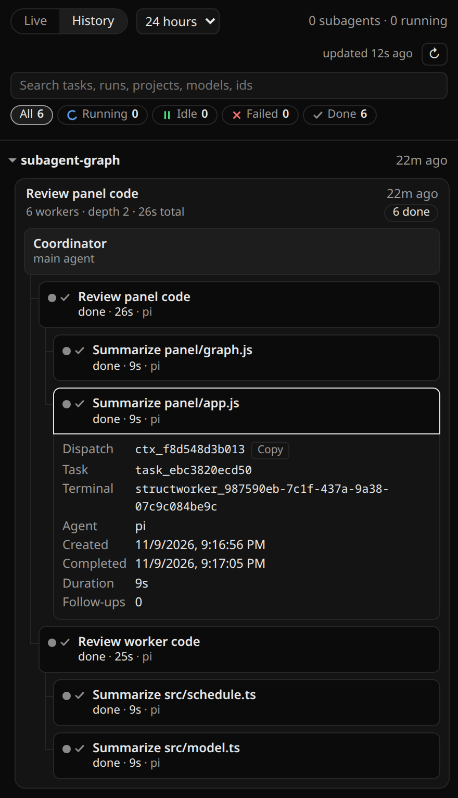

# Subagent Graph (Orca plugin)

Counts your Orca orchestration subagents in the status bar and draws each run as a nested graph: coordinator, then the workers it started, then the workers they started. It can watch this machine and any paired Orca servers, so a Windows desktop can show the workers running on a headless Linux box.

## Install

In Orca, open Settings → Plugins → Install plugin → Git URL and paste:

    https://github.com/ChandraLiuswanto/orca-subagent-graph

Or from a terminal:

    orca plugin install ChandraLiuswanto/orca-subagent-graph

The CLI stops with `approval_required` and prints the same command with an `--approve` fingerprint. Run that command to finish.

The plugin runs a small background worker that calls the `orca` CLI, so Orca asks you to approve full access before it starts. Enable it, then open Subagents in the right sidebar.

Plugins run in the Orca desktop app. A headless `orca serve` runtime has no plugin service, but the desktop app can still watch it as a paired server.

## What you see

The status bar shows "N subagents", where N is running workers plus idle workers whose terminal is still open. The item is hidden when N is 0 and shows `subagents ?` when no host answers. Its tooltip splits the count into running and idle, lists up to three projects with active workers, and says how deep the nesting goes. Clicking it toggles the right sidebar.

The Subagents panel has two views:

- Live shows runs with running or idle workers, plus runs that finished in the last hour, across every project. If there are none, it shows each project's newest run instead.
- History shows every run in a range: 24h, 7d, 30d or All.

Runs are grouped under collapsible project headers, and each run is a collapsible tree. Follow-ups sent to the same worker fold into one node. Nodes show a status and a duration, and a search box filters them. Click a node for its details and a Focus terminal button.

Subagents started inside a Pi session (pi-subagents) don't appear, because Orca's orchestration never records them.

## Settings

- Orca hosts to watch: `auto` (the default) watches this machine plus every server in `orca environment list`. You can also give a comma-separated list such as `local,fedora`, using the names from that command.
- Orca CLI path: only needed if the plugin can't find `orca.exe` or `orca` on its own.

## How it gets its data

Everything comes from the `orca` CLI (`orchestration worker-list`, `worker-show`, `task-list` and `run-list`), so the plugin works the same on Windows, macOS and Linux.

The worker does only as much as the open view needs. With the panel closed or hidden, it fetches just enough for the status bar count. Live loads details for live and recent runs, and History loads its range when you open it. Each host polls on its own, so a slow paired server doesn't hold up local results. The refresh button asks for a new pass, and the panel header shows when each host last answered.

Details for finished workers are saved with `storage:own` and reused after a restart. If storage isn't available, the worker keeps them in memory for the session.

## Upgrading to 0.4.0

0.4.0 added the `storage:own` capability. Orca asks you to approve again after the update, and the new version won't run until you do.

## Development

Run the tests:

    node --test src/*.test.ts

To clear saved details and what the worker knows about closed terminals in a development plugin:

    orca plugin dev request . graph.clearCache --json

The next passes rebuild the cache from the CLI.
